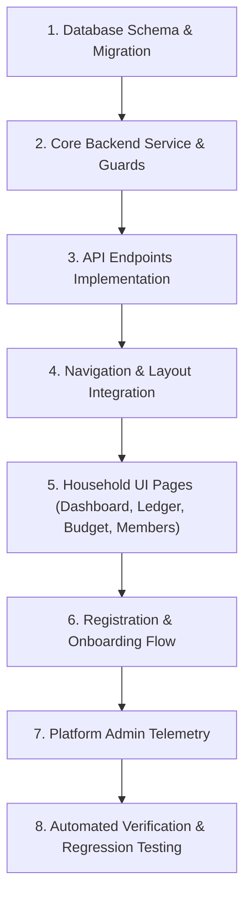

# PakkaChittha Ghar Kharcha — Implementation Plan

## 1. Plan Overview

This plan defines the step-by-step implementation sequence for **PakkaChittha Ghar Kharcha (Free Household Mode)** in the existing PakkaChittha application.

Every step adheres to production safety rules:
- Strictly additive database schema changes.
- Zero disruption to existing billing, subscriptions, invoices, and business accounting.
- Permanent 100% free household tracking with multi-member collaboration.
- Server-side cryptographic authorization on all endpoints.

---

## 2. Implementation Sequence

---

## 3. Step-by-Step Execution Plan

### Step 1: Database Schema & Migration
1. Update `prisma/schema.prisma` with:
   - `HouseholdRole` enum (`OWNER`, `ADMIN`, `MEMBER`, `VIEWER`).
   - `HouseholdTransactionType` enum (`INCOME`, `EXPENSE`).
   - `HouseholdInviteStatus` enum (`PENDING`, `ACCEPTED`, `EXPIRED`, `REVOKED`).
   - `Household` model.
   - `HouseholdMember` model with `@@unique([userId, householdId])`.
   - `HouseholdInvitation` model with single-use expiring token.
   - `HouseholdCategory` model (scoped to household or default).
   - `HouseholdTransaction` model with decimal-safe amounts and category audit snapshot.
   - `HouseholdMonthlyBudget` model with `@@unique([householdId, monthYear])`.
   - Link relations to `User` model (`householdMemberships`, `createdHouseholdTransactions`, `sentHouseholdInvitations`).
2. Run safe Prisma migration: `npx prisma db push` or `prisma migrate dev --name add_ghar_kharcha_household_models`.
3. Generate updated Prisma client: `npx prisma generate`.

### Step 2: Core Backend Services & Authorization Guards
1. Create `src/lib/household/defaultCategories.ts`:
   - Pre-configured standard Indian household expense and income categories with icons and colors.
2. Create `src/lib/household/guards.ts`:
   - `requireHouseholdAccess(householdId?, allowedRoles?)`: Resolves authenticated user, verifies active household membership, enforces RBAC.
3. Create `src/lib/household/householdService.ts`:
   - `createHousehold(userId, name, currency, monthlyBudget)`: Creates household, links creator as `OWNER`, seeds default categories.
   - `getHouseholdDashboard(householdId, monthYear)`: Aggregates income, expenses, cash flow, budget utilization, category breakdowns, and trends.
   - `getHouseholdTransactions(householdId, filters, pagination)`: Filter by date, category, type, search term.
   - `createTransaction(householdId, userId, data)`: Validates positive amount, date, category; creates transaction.
   - `updateTransaction(householdId, userId, userRole, transactionId, data)`: Checks permissions and updates.
   - `deleteTransaction(householdId, userId, userRole, transactionId)`: Deletes transaction safely.
   - `manageBudget(householdId, monthYear, amount)`: Sets or updates monthly budget.
   - `inviteFamilyMember(householdId, inviterId, email, role)`: Generates cryptographic 72-hour single-use token.
   - `acceptInvitation(userId, token)`: Validates token, links user to household.

### Step 3: API Route Handlers
1. `/api/household/route.ts`: GET current user households, POST create new household.
2. `/api/household/transactions/route.ts`: GET paginated list, POST create record.
3. `/api/household/transactions/[id]/route.ts`: PATCH update, DELETE remove.
4. `/api/household/categories/route.ts`: GET all categories, POST create custom.
5. `/api/household/categories/[id]/route.ts`: PATCH update, DELETE remove custom.
6. `/api/household/budget/route.ts`: GET monthly budget summary, POST/PUT set budget.
7. `/api/household/members/route.ts`: GET members list, PATCH change role, DELETE remove member.
8. `/api/household/invitations/route.ts`: GET active invites, POST send invite, DELETE revoke.
9. `/api/household/invitations/accept/route.ts`: POST accept token.
10. `/api/household/export/route.ts`: GET stream CSV export.
11. `/api/household/switch/route.ts`: POST set active household.
12. `/api/auth/register-household/route.ts`: POST register new user and directly provision household.

### Step 4: Navigation, Layout, and Workspace Switching
1. `src/data/navigation.ts`: Add `HOUSEHOLD_NAVIGATION_ITEMS` and `GHAR_KHARCHA` navigation group.
2. `src/components/layout/AppShell.tsx`:
   - Ensure `/ghar-kharcha` routes bypass `TrialExpiredLockScreen` entirely.
3. `src/components/layout/Header.tsx`:
   - Add "Ghar Kharcha" title mapping and active household indicator with quick-switch toggle.
4. `src/components/layout/Sidebar.tsx`:
   - Render `HOUSEHOLD_NAVIGATION_ITEMS` when viewing `/ghar-kharcha` routes.
5. `src/middleware.ts`: Add `/ghar-kharcha/join` and public invite validation to public paths.

### Step 5: Household UI Pages
1. `/ghar-kharcha/page.tsx`:
   - Responsive Household Dashboard.
   - KPI Summary Cards: Total Income, Total Expenses, Net Cash Flow, Monthly Budget, Remaining, Utilization %.
   - Visual Charts: Monthly trend (Income vs Expense), Category Breakdown (Pie/Donut & Bar).
   - Quick Add Transaction Modal (Mobile-first, single hand friendly).
   - Recent Transactions preview.
2. `/ghar-kharcha/transactions/page.tsx`:
   - Filterable, searchable transaction ledger with pagination, date pickers, category filters, and CSV export.
   - Edit and delete actions with confirmation dialogs.
3. `/ghar-kharcha/budget/page.tsx`:
   - Monthly budget planner, category budget allocations, progress meters.
4. `/ghar-kharcha/categories/page.tsx`:
   - Custom category manager, icons, colors, delete guards.
5. `/ghar-kharcha/members/page.tsx`:
   - Family collaboration center, member roles (Owner, Admin, Member, Viewer), pending invite links with copy-to-clipboard.
6. `/ghar-kharcha/setup/page.tsx`:
   - Guided household setup wizard for newly registered users.
7. `/ghar-kharcha/join/page.tsx`:
   - Invitation redemption landing page for family members.

### Step 6: Registration & Login Integration
1. `src/app/register/page.tsx`:
   - Add "Ghar Kharcha" option tab.
   - Instant onboarding with zero payment, zero credit card, zero trial countdown.
2. `src/app/login/page.tsx`:
   - Support `redirect=/ghar-kharcha` or automatic detection of household-only users.

### Step 7: Platform Admin Panel Telemetry
1. Update `/api/platform-admin/overview/route.ts` to compute:
   - `totalHouseholds`, `activeHouseholds`, `totalHouseholdMembers`, `totalHouseholdTransactions`.
2. Update `src/app/platform-admin/page.tsx` with a clean "Ghar Kharcha Household Usage" metrics card (without exposing private transaction descriptions).

### Step 8: Automated Verification & Testing
1. Create `scripts/test-ghar-kharcha.ts` covering:
   - Registration and household creation.
   - Income & expense transaction creation, update, deletion.
   - Category creation and defaults.
   - Monthly budget tracking and utilization.
   - Family collaboration: invitation creation, acceptance, and role enforcement.
   - Cross-household security isolation tests (User A cannot view or manipulate Household B data).
   - Viewer role enforcement (read-only cannot write).
   - Zero billing side effects (no subscription or Razorpay impact).
2. Run full project test suite:
   - `npx tsx scripts/test-ghar-kharcha.ts`
   - `npx tsx scripts/test-package-entitlements.ts`
   - `npm run test:free-khata`
   - `npm run lint`
   - `npm run build`

---

## 4. Rollback Strategy
- **Additive Schema**: If needed, dropping the new household tables or disabling the feature flag `FEATURE_GHAR_KHARCHA=false` completely isolates the feature with zero impact on existing business data.
- **Billing Safety**: No business subscriptions, packages, or payment records will ever be altered.
